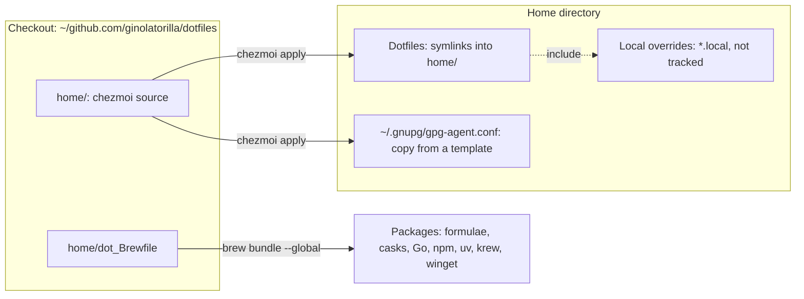

# Gino Latorilla's dotfiles

This repo sets up the home directory of each Machine: [chezmoi](https://www.chezmoi.io/)
places the Dotfiles, and [Homebrew](https://brew.sh/) installs the Packages.
macOS is the primary Platform. Linux under WSL 2 (Ubuntu 24.04) is the
secondary Platform. [docs/CONTEXT.md](docs/CONTEXT.md) defines the terms that
this README uses.



Each Dotfile is a symlink into the Checkout, so an edit to a Dotfile is an
edit to the Checkout. Templates, such as `gpg-agent.conf`, are copies.

## Before you begin

- A Mac, or an Ubuntu 24.04 distro under WSL 2.
- A shell, `curl` and `git`. Setup needs no Python virtual environment.
- An account that can run `sudo`.

## Setting up a Machine

1. Run `install.sh` from the repo:

    ```sh
    bash -c "$(curl -fsSL https://raw.githubusercontent.com/ginolatorilla/dotfiles/main/install.sh)"
    ```

    If you already have a Checkout, run `./install.sh` in it instead.

    The script does these steps. It skips each step that is already done:

    1. On Linux, installs `build-essential procps curl file git` with
       `apt-get`.
    1. Installs Homebrew and chezmoi.
    1. Clones the repo to `~/github.com/ginolatorilla/dotfiles` if you run it
       from `curl`.
    1. Runs `chezmoi init --apply`, which places the Dotfiles and then runs
       `brew bundle --global` and `fisher update`.
    1. Installs the Packages and fish plugins that are still missing.
    1. Makes Homebrew fish the login shell.

1. Copy the Secrets by hand. The repo and the Local overrides never hold
   Secrets.
    - Copy the ssh key to `~/.ssh/id_rsa.ginolatorilla` and run
      `chmod 600 ~/.ssh/id_rsa.ginolatorilla`.
    - Import the gpg key with `gpg --import`.

1. Write the Local overrides for this Machine. See
   [Adding Machine-specific settings](#adding-machine-specific-settings).

1. Open a new terminal and make sure that fish starts with no errors.

### Setting up the Windows side of WSL

Do these steps on the Windows PC. The PC hosts the Machine but is not one
(see [ADR 0001](docs/adr/0001-windows-only-through-wsl.md)).

1. Install WSL 2 and Ubuntu 24.04:

    ```powershell
    wsl --install -d Ubuntu-24.04
    ```

1. Install the ComicShannsMono Nerd Font and the Fira Code Nerd Font from the
   [Nerd Fonts releases](https://github.com/ryanoasis/nerd-fonts/releases).
   These fonts have no winget ID, so `brew bundle` cannot install them.
1. In Windows Terminal, set the font of the Ubuntu profile to a Nerd Font.

`brew bundle` installs Docker Desktop through winget when you run
`install.sh` in the distro.

## Running Setup again

To get the latest changes from the repo, pull and run `install.sh` again:

```sh
cd ~/github.com/ginolatorilla/dotfiles
git pull
./install.sh
```

If you changed or deleted a Dotfile or an external file by hand, chezmoi asks
before it restores the file, and `install.sh` stops if there is no terminal.
Run `./install.sh --force` to restore the file without a question.

chezmoi runs `brew bundle --global` again only if `home/dot_Brewfile` or
`~/.Brewfile.local` changed. `install.sh` also installs each Package and fish
plugin that is missing, for example one that you removed by hand.

Software that has no Homebrew formula, such as the zjstatus plugin of Zellij,
comes from `home/.chezmoiexternal.toml`. chezmoi downloads it with a pinned
version and checks the SHA-256.

## Checking for Drift

To see what Setup would change on a Machine, without changing anything,
run:

```sh
./install.sh --check
```

The command also works before the first Setup, for example on a Machine with
no Homebrew or with a chezmoi from outside Homebrew. It prints one line for
each Setup step:

- `ok`: Setup would change nothing in this step.
- `drift`: Setup would change something. The details are below the line.
- `not checked`: an earlier step is missing, so `--check` cannot check this
  step. This counts as Drift.

The steps are the apt prerequisites (Linux only), Homebrew, the Checkout, the
chezmoi config, the Dotfiles, the Packages, the fish plugins and the login
shell. Outdated Packages are not Drift.

The command exits with status 0 if there is no Drift, 1 if there is Drift,
and 2 if there is an error. With `--dotfiles-only`, it checks only what
`./install.sh --dotfiles-only` would change.

Some Packages replace their Dotfile instead of editing it. The symlink then
becomes a regular file, and the Dotfiles step shows it.

## Adding a Package

1. Add the entry to `home/dot_Brewfile`, in the group it belongs to.
    - Put casks and macOS-only formulae under `if OS.mac?`.
    - Put Linux-only entries under `if OS.linux?`.
    - Put `winget` entries under `if OS.wsl?`.
    - Put Private Packages in `~/.Brewfile.local` instead.
1. Run `chezmoi apply`. chezmoi sees the change and runs `brew bundle
   --global`.

Before you run `brew bundle cleanup --global --force`, run it without
`--force` and read the list. The command also removes Go, npm, uv, krew and
cargo packages that are not listed.

## Adding a Dotfile

1. Copy the file into the chezmoi source:

    ```sh
    chezmoi add ~/.config/example/config.toml
    ```

1. Replace the file with a symlink into the Checkout:

    ```sh
    chezmoi apply ~/.config/example/config.toml
    ```

1. Make the file work on macOS and Linux. Use the conditional syntax of the
   file format. Use a chezmoi template only if the format has no conditional
   syntax.

## Adding Machine-specific settings

Private settings, such as organisation names and internal hostnames, go only
in Local overrides (see
[ADR 0003](docs/adr/0003-private-items-in-local-overrides.md)). Each
Dotfile below includes its Local override if the file exists:

| Dotfile | Local override |
|---|---|
| `~/.config/fish/config.fish` | `~/.config/fish/config.fish.local` |
| `~/.bashrc` | `~/.bashrc.local` |
| `~/.gitconfig` | `~/.gitconfig.local` |
| `~/.ssh/config` | `~/.ssh/config.local` |
| `~/.Brewfile` | `~/.Brewfile.local` |

## Testing install.sh

The test runs `install.sh` with a scratch home directory and stubs for
`brew`, `fish`, `chsh` and `sudo`, so it changes nothing on the Machine and
installs no Package. It needs `git` and chezmoi.

1. Run the test:

    ```sh
    tests/install_test.sh
    ```

1. Make sure that the last line of the output is `All tests passed.`

## Repo layout

```text
.
├── .chezmoiroot                  # Sets home/ as the chezmoi source
├── .github/workflows/check.yml   # CI check on macOS and Ubuntu
├── home/                         # chezmoi source: the Dotfiles
│   ├── .chezmoi.toml.tmpl        # chezmoi config: source dir, symlink mode
│   ├── .chezmoiignore            # Paths not placed on Linux
│   ├── dot_Brewfile              # The Packages
│   └── run_onchange_after_*.sh.tmpl
├── docs/CONTEXT.md               # Glossary
├── docs/adr/                     # Decision records
├── install.sh                    # Setup and --check
└── tests/install_test.sh         # Sandbox test for install.sh
```

Inspired by [cowboy/dotfiles](https://github.com/cowboy/dotfiles).
