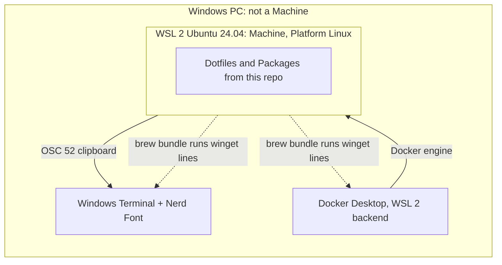

# Windows is supported only through WSL

On a Windows PC, the Machine is a WSL 2 distro (Ubuntu 24.04 is the tested target), and Windows itself is not a Platform. Dotfiles never call into Windows: the clipboard goes through OSC 52, gpg uses a terminal pinentry, and ssh uses a Linux agent, so what works in WSL also works on native Linux. Native Windows was rejected because the login shell (fish) and the package manager (Homebrew) have no native Windows builds, so it would need a second shell configuration and a second package list to run the same tools that WSL already runs.

## Consequences

- The Windows side (Docker Desktop, the Nerd Font) is installed by `winget` lines in the Brewfile, under `if OS.wsl?`. `brew bundle` runs them from inside WSL, and they do nothing on macOS or native Linux. A Windows package with no winget ID becomes a README step instead. Windows Terminal ships with Windows 11 and is not listed.
- WSL 1 is not supported: Homebrew treats it as Tier 3.

## Native Windows limitations

Researched on 2026-11-21. Check these again before you reopen this decision.

| Area | Native Windows status | Source |
|---|---|---|
| fish | No native build. fish 4 runs only under WSL or MSYS2. The replacement is a PowerShell profile. | https://fishshell.com/blog/rustport/ |
| Homebrew | Not supported on Windows. The replacement is a winget list (`winget import`, `winget configure`) or a scoop list (`scoop import`), with different package IDs. | https://docs.brew.sh/Support-Tiers |
| tmux | No native build. Upstream says native Windows is unlikely. | https://github.com/tmux/tmux/discussions/3682 |
| zellij | Native since 0.44.0 (March 2026). Binaries are unsigned, and Smart App Control or WDAC can block them; no signing is planned (#5913). Special keys are garbled over SSH to a Windows host (#5956, open). | https://zellij.dev/documentation/faq |
| Ghostty | No Windows GUI. The 1.4 release dropped the Windows roadmap. Windows Terminal supports OSC 52 clipboard writes. | https://ghostty.org/docs/install/release-notes/1-4-0, https://github.com/microsoft/terminal/issues/2946 |
| Docker | The CLI is native. The engine needs Docker Desktop with the WSL 2 or Hyper-V backend. | https://docs.docker.com/desktop/setup/install/windows-install/ |
| replicated CLI | No Windows release assets. | https://github.com/replicatedhq/replicated/releases |
| skopeo | No Windows release assets. | https://github.com/containers/skopeo/releases |
| btop | No upstream Windows build. btop4win is a separate port. | https://github.com/aristocratos/btop4win |
| lima | Windows zips exist since 2.x. The support level is not documented. | https://github.com/lima-vm/lima/releases |
| chezmoi | Native. Symlinks need Developer Mode. | https://www.chezmoi.io/user-guide/machines/windows/ |
| Other CLI tools | Native builds exist for bat, eza, fd, ripgrep, zoxide, atuin, fzf, yazi, lazygit, k9s, kubectl, helm, argocd, terraform, opentofu, vault, starship, neovim, delta and gh. | Each project's GitHub releases |
