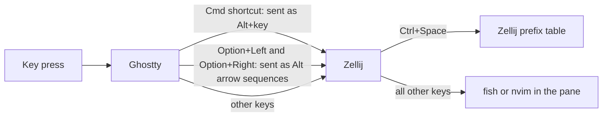

# Key cheatsheet

This file lists the keys of Ghostty, Zellij, nvim and fish. Use it to find the key for an action and to see which layer reads the key.

## Key path

A key press goes through the layers in this order. Zellij binds only Ctrl+Space. Zellij sends all other keys to the pane, so that nvim and fish get all Alt and Ctrl keys.

## Cmd shortcuts

Ghostty sends each Cmd shortcut as Alt+key (ESC and the key). nvim maps the `<M-key>` form. The `<M-key>` keys work in normal, insert and visual mode, unless the table says other.

| Cmd shortcut | Ghostty sends | nvim action |
|---|---|---|
| Cmd+P | Alt+p | Quick open (find files) |
| Cmd+Shift+P | Alt+Shift+p | Command palette |
| Cmd+Shift+F | Alt+Shift+f | Search in files (live grep) |
| Cmd+B | Alt+b | Toggle the file tree |
| Cmd+S | Alt+s | Save the file |
| Cmd+J | Alt+j | Toggle the terminal panel (also in terminal mode) |
| Cmd+/ | Alt+/ | Toggle the comment |
| Cmd+Shift+V | Alt+Shift+v | Toggle the Markdown preview (markdown buffers only) |

Cmd shortcuts at the fish prompt are not supported. fish reads Alt+s as "put `sudo` before the command" and Alt+p as "add `| less`".

## Option+Left and Option+Right

Ghostty sends the Alt arrow sequences for these keys. The default Ghostty key sends ESC b, which is the same as Cmd+B.

| Key | fish | nvim |
|---|---|---|
| Option+Left | Move one word back | Move one word back (`<S-Left>`) |
| Option+Right | Move one word forward | Move one word forward (`<S-Right>`) |

## Zellij prefix table

Press Ctrl+Space, then the key. Each key does one action and goes back to Normal mode, except the keys that the table marks as "stays".

| Key after Ctrl+Space | Action |
|---|---|
| `v` | New pane on the right |
| `s` | New pane below |
| `h` `j` `k` `l`, arrow keys | Move the focus left, down, up, right |
| `o` | Focus the next pane |
| `;` | Focus the last pane |
| `x` | Close the focused pane |
| `z` | Toggle full screen for the focused pane |
| `c` | New tab |
| `n` / `p` | Next tab / previous tab |
| `1` to `9` | Go to tab 1 to 9 |
| `,` | Rename the tab (stays in the rename mode) |
| `&` | Close the tab |
| `[` | Scroll mode (stays) |
| `d` | Detach the session |
| `w` | Session manager (floating) |
| `Space` | Next swap layout |
| `Ctrl+Space` | Send Ctrl+Space to the pane |
| `f` | Show or hide the floating panes |
| `F` | New floating pane |
| `r` | Resize mode (stays) |
| `m` | Move mode (stays) |
| `q` | Quit (Zellij asks first) |
| `Esc` | Go back to Normal mode |

### Zellij modes with their own keys

| Mode | Keys |
|---|---|
| Scroll | `j` `k` line down and up. `h` `l` or `Ctrl+b` `Ctrl+f` page up and down. `d` `u` half page down and up. `[` `]` previous and next prompt. `m` select the command at the scroll position. `s` search. `e` edit the scrollback. `c` copy the last command output. `Ctrl+c` go to the bottom. `Esc` or `Enter` leave. |
| Search | `n` `p` next and previous match. `c` case sensitivity. `w` wrap. `o` whole word. The Scroll keys for movement also work. |
| Resize | `h` `j` `k` `l` increase the pane in that direction. `H` `J` `K` `L` decrease. `=` or `+` increase. `-` decrease. `Esc` or `Enter` leave. |
| Move | `h` `j` `k` `l` or arrow keys move the pane. `n` or `Tab` move to the next position. `p` move back. `Esc` or `Enter` leave. |
| Rename | Type the name. `Enter` keep the name. `Esc` undo and leave. |

## nvim

The leader key is Space.

### Leader keys

| Key | Action |
|---|---|
| `<leader>p` | Quick open (find files) |
| `<leader>;` | Command palette |
| `<leader>g` | Text search (live grep) |
| `<leader>N` | Toggle the file tree |
| `<leader>t` | Toggle the terminal |
| `<leader>i` | Focus the terminal |
| `<leader>mp` | Toggle the Markdown preview (markdown buffers only) |
| `<leader>s` / `<leader>v` | Split the window horizontally / vertically |
| `<leader>h` `j` `k` `l` | Move to the window on the left, below, above, right |
| `<leader>` and an arrow key | Same as `<leader>h` `j` `k` `l` |
| `<leader>w` `b` `e` | CamelCaseMotion word motions |
| `Esc Esc` in the terminal | Go to normal mode |

### LSP keys

These keys are set when an LSP server attaches to the buffer.

| Key | Action |
|---|---|
| `gd` | Go to definition |
| `gD` | Peek definition |
| `gI` | Peek implementations |
| `gy` | Go to type definition |
| `gR` | References (list and preview) |
| `gh` | Hover |
| `<leader>o` | Document symbols |
| `<leader>O` | Workspace symbols |
| `<leader>rn` | Rename |
| `<leader>.` | Code action |

The built-in `gi` (insert at the last insert position) and `g]` (select a tag) are not changed.

### Other keys

| Key | Action |
|---|---|
| `gr`, `grr` | ReplaceWithRegister |
| `grx` | nvim default |
| `<` and `>` in visual mode | Change the indent and keep the selection |
| `Down` and `Up` in the command line | Pick a menu item while the menu is open. Otherwise browse the history |
